<!-- Erzeugt von tools/build.py – bitte dort ändern. -->
<p align="right"><sub><a href="README.md">Deutsch</a> · <b>English</b> · <a href="README.tr.md">Türkçe</a></sub></p>

<a href="https://github.com/Emre1001"><picture><source media="(prefers-color-scheme: dark)" srcset="assets/en/dark/hero.svg"><source media="(prefers-color-scheme: light)" srcset="assets/en/light/hero.svg"></picture></a>

<div align="center">

### Software that runs on <b>your</b> device – not on someone else's servers.

From the TV to the phone to the PC: I build apps without accounts, subscriptions or tracking.<br>
Local, fast, open source. And designed with care for the details.

</div>

## What I build

<p align="center">
  <a href="https://github.com/Emre1001/CinemaMax"><picture><source media="(prefers-color-scheme: dark)" srcset="assets/en/dark/cards/cinemamax.svg"><source media="(prefers-color-scheme: light)" srcset="assets/en/light/cards/cinemamax.svg"></picture></a>
  <a href="https://github.com/Emre1001/Screen-Clean"><picture><source media="(prefers-color-scheme: dark)" srcset="assets/en/dark/cards/screen-clean.svg"><source media="(prefers-color-scheme: light)" srcset="assets/en/light/cards/screen-clean.svg"></picture></a>
  <a href="https://github.com/Emre1001/speedload"><picture><source media="(prefers-color-scheme: dark)" srcset="assets/en/dark/cards/speedload.svg"><source media="(prefers-color-scheme: light)" srcset="assets/en/light/cards/speedload.svg"></picture></a>
  <a href="https://github.com/Emre1001/Giga-Share"><picture><source media="(prefers-color-scheme: dark)" srcset="assets/en/dark/cards/giga-share.svg"><source media="(prefers-color-scheme: light)" srcset="assets/en/light/cards/giga-share.svg"></picture></a>
  <a href="https://github.com/Emre1001/Werwolf-Mobile"><picture><source media="(prefers-color-scheme: dark)" srcset="assets/en/dark/cards/werwolf-mobile.svg"><source media="(prefers-color-scheme: light)" srcset="assets/en/light/cards/werwolf-mobile.svg"></picture></a>
  <a href="https://github.com/Emre1001/Gym-Ranker"><picture><source media="(prefers-color-scheme: dark)" srcset="assets/en/dark/cards/gym-ranker.svg"><source media="(prefers-color-scheme: light)" srcset="assets/en/light/cards/gym-ranker.svg"></picture></a>
</p>

<details>
<summary><b>More from the workshop</b></summary>
<br>

| Project | What it does |
|---|---|
| [YT Music → MP3](https://github.com/Emre1001/Ytms-to-mp3) | Turns playlists into MP3s. Windows, Linux, Android |
| [Phone-Cam](https://github.com/Emre1001/Phone-Cam) | Turns your phone into a wireless HD webcam |
| [Debloatranium](https://github.com/Emre1001/Debloatranium) | Portable Windows debloater, from Light to Max |
| [LaunchDeck](https://github.com/Emre1001/LaunchDeck) | All-in-one game launcher for Windows |
| [Financely](https://github.com/Emre1001/Financely) | Finance tracker as a PWA, no build step |

</details>

## Toolbox

<p align="center">
  <picture><source media="(prefers-color-scheme: light)" srcset="https://skillicons.dev/icons?i=rust,flutter,dart,kotlin,androidstudio,ts,react,tauri,firebase,linux,html,css&perline=12&theme=light"></picture>
</p>

## How I build

```diff
+ Local first       Data stays on the device. The AI too.
+ Small & fast      Speedload: one file, 2 MB. No Electron unless it has to be.
+ Everywhere        Android TV, phone, Linux, Windows, browser.
+ Open              MIT license. Read the code, build it yourself.
- Accounts, subscriptions, ads, tracking
```

<a href="https://github.com/Emre1001?tab=repositories"><picture><source media="(prefers-color-scheme: dark)" srcset="assets/en/dark/footer.svg"><source media="(prefers-color-scheme: light)" srcset="assets/en/light/footer.svg"></picture></a>
