<a href="https://github.com/Emre1001"></a>

<div align="center">

### Software, die auf **deinem** Gerät läuft – nicht auf fremden Servern.

Vom Fernseher übers Handy bis zum Mikrocontroller: Ich baue Apps ohne Konto, ohne Abo und ohne Tracking.<br>
Lokal, schnell, quelloffen. Und mit Liebe zum Detail im Design.

</div>

<br>

## ⚡ Was ich baue

<p align="center">
  <a href="https://github.com/Emre1001/CinemaMax"></a>
  <a href="https://github.com/Emre1001/kelimo"></a>
  <a href="https://github.com/Emre1001/speedload"></a>
  <a href="https://github.com/Emre1001/Giga-Share"></a>
  <a href="https://github.com/Emre1001/Jarvis"></a>
  <a href="https://github.com/Emre1001/macropad"></a>
</p>

<details>
<summary><b>🧪 Noch mehr aus der Werkstatt</b></summary>
<br>

| Projekt | Was es macht |
|---|---|
| [Screen-Clean](https://github.com/Emre1001/Screen-Clean) | P2P-Bildschirmfreigabe & Fernsteuerung in Rust, mit Live-Cursorn aller Zuschauer |
| [YT Music → MP3](https://github.com/Emre1001/Ytms-to-mp3) | Aus Playlists werden MP3s. Windows, Linux, Android |
| [Phone-Cam](https://github.com/Emre1001/Phone-Cam) | Macht dein Handy zur kabellosen HD-Webcam |
| [Werwolf Mobile](https://github.com/Emre1001/Werwolf-Mobile) | Das Werwolf-Spiel für den Spieleabend, auf einem Handy |
| [Gym Ranker](https://github.com/Emre1001/Gym-Ranker) | Gnadenloses Fitness-Ranking, Hardcore Edition |
| [Debloatranium](https://github.com/Emre1001/Debloatranium) | Portabler Windows-Debloater von Light bis Max |
| [LaunchDeck](https://github.com/Emre1001/LaunchDeck) | All-in-One-Game-Launcher für Windows |
| [Financely](https://github.com/Emre1001/Financely) | Finanz-Tracker als PWA, ohne Build-Schritt |

</details>

## 🧰 Werkzeugkasten

<p align="center">
  
</p>

## 🧭 Wie ich baue

```diff
+ Lokal zuerst       Daten bleiben auf dem Gerät. Die KI auch.
+ Klein & schnell    Speedload: eine Datei, 2 MB. Kein Electron, wenn's nicht sein muss.
+ Überall            Android TV, Handy, Linux, Windows, ESP32.
+ Offen              MIT-Lizenz. Lies den Code, bau ihn selbst.
- Konten, Abos, Werbung, Tracking
```

<a href="https://github.com/Emre1001?tab=repositories"></a>
