<!-- Erzeugt von tools/build.py – bitte dort ändern. -->
<p align="right"><sub><b>Deutsch</b> · <a href="README.en.md">English</a> · <a href="README.tr.md">Türkçe</a></sub></p>

<a href="https://github.com/Emre1001"><picture><source media="(prefers-color-scheme: dark)" srcset="assets/de/dark/hero.svg"><source media="(prefers-color-scheme: light)" srcset="assets/de/light/hero.svg"></picture></a>

<div align="center">

### Software, die auf <b>deinem</b> Gerät läuft – nicht auf fremden Servern.

Vom Fernseher übers Handy bis zum PC: Ich baue Apps ohne Konto, ohne Abo und ohne Tracking.<br>
Lokal, schnell, quelloffen. Und mit Liebe zum Detail im Design.

</div>

## Was ich baue

<p align="center">
  <a href="https://github.com/Emre1001/CinemaMax"><picture><source media="(prefers-color-scheme: dark)" srcset="assets/de/dark/cards/cinemamax.svg"><source media="(prefers-color-scheme: light)" srcset="assets/de/light/cards/cinemamax.svg"></picture></a>
  <a href="https://github.com/Emre1001/Screen-Clean"><picture><source media="(prefers-color-scheme: dark)" srcset="assets/de/dark/cards/screen-clean.svg"><source media="(prefers-color-scheme: light)" srcset="assets/de/light/cards/screen-clean.svg"></picture></a>
  <a href="https://github.com/Emre1001/speedload"><picture><source media="(prefers-color-scheme: dark)" srcset="assets/de/dark/cards/speedload.svg"><source media="(prefers-color-scheme: light)" srcset="assets/de/light/cards/speedload.svg"></picture></a>
  <a href="https://github.com/Emre1001/Giga-Share"><picture><source media="(prefers-color-scheme: dark)" srcset="assets/de/dark/cards/giga-share.svg"><source media="(prefers-color-scheme: light)" srcset="assets/de/light/cards/giga-share.svg"></picture></a>
  <a href="https://github.com/Emre1001/Werwolf-Mobile"><picture><source media="(prefers-color-scheme: dark)" srcset="assets/de/dark/cards/werwolf-mobile.svg"><source media="(prefers-color-scheme: light)" srcset="assets/de/light/cards/werwolf-mobile.svg"></picture></a>
  <a href="https://github.com/Emre1001/Gym-Ranker"><picture><source media="(prefers-color-scheme: dark)" srcset="assets/de/dark/cards/gym-ranker.svg"><source media="(prefers-color-scheme: light)" srcset="assets/de/light/cards/gym-ranker.svg"></picture></a>
</p>

<details>
<summary><b>Noch mehr aus der Werkstatt</b></summary>
<br>

| Projekt | Was es macht |
|---|---|
| [YT Music → MP3](https://github.com/Emre1001/Ytms-to-mp3) | Aus Playlists werden MP3s. Windows, Linux, Android |
| [Phone-Cam](https://github.com/Emre1001/Phone-Cam) | Macht dein Handy zur kabellosen HD-Webcam |
| [Debloatranium](https://github.com/Emre1001/Debloatranium) | Portabler Windows-Debloater von Light bis Max |
| [LaunchDeck](https://github.com/Emre1001/LaunchDeck) | All-in-One-Game-Launcher für Windows |
| [Financely](https://github.com/Emre1001/Financely) | Finanz-Tracker als PWA, ohne Build-Schritt |

</details>

## Werkzeugkasten

<p align="center">
  <picture><source media="(prefers-color-scheme: light)" srcset="https://skillicons.dev/icons?i=rust,flutter,dart,kotlin,androidstudio,ts,react,tauri,firebase,linux,html,css&perline=12&theme=light"></picture>
</p>

## Wie ich baue

```diff
+ Lokal zuerst       Daten bleiben auf dem Gerät. Die KI auch.
+ Klein & schnell    Speedload: eine Datei, 2 MB. Kein Electron, wenn's nicht sein muss.
+ Überall            Android TV, Handy, Linux, Windows, Browser.
+ Offen              MIT-Lizenz. Lies den Code, bau ihn selbst.
- Konten, Abos, Werbung, Tracking
```

<a href="https://github.com/Emre1001?tab=repositories"><picture><source media="(prefers-color-scheme: dark)" srcset="assets/de/dark/footer.svg"><source media="(prefers-color-scheme: light)" srcset="assets/de/light/footer.svg"></picture></a>
