<!-- Erzeugt von tools/build.py – bitte dort ändern. -->
<p align="right"><sub><a href="README.md">Deutsch</a> · <a href="README.en.md">English</a> · <b>Türkçe</b></sub></p>

<a href="https://github.com/Emre1001"><picture><source media="(prefers-color-scheme: dark)" srcset="assets/tr/dark/hero.svg"><source media="(prefers-color-scheme: light)" srcset="assets/tr/light/hero.svg"></picture></a>

<div align="center">

### Yabancı sunucularda değil, <b>senin</b> cihazında çalışan yazılımlar.

Televizyondan telefona, telefondan bilgisayara: Hesapsız, aboneliksiz ve takipsiz uygulamalar geliştiriyorum.<br>
Yerel, hızlı, açık kaynak. Ve tasarımda her ayrıntıya özen.

</div>

## Neler geliştiriyorum

<p align="center">
  <a href="https://github.com/Emre1001/CinemaMax"><picture><source media="(prefers-color-scheme: dark)" srcset="assets/tr/dark/cards/cinemamax.svg"><source media="(prefers-color-scheme: light)" srcset="assets/tr/light/cards/cinemamax.svg"></picture></a>
  <a href="https://github.com/Emre1001/kelimo"><picture><source media="(prefers-color-scheme: dark)" srcset="assets/tr/dark/cards/kelimo.svg"><source media="(prefers-color-scheme: light)" srcset="assets/tr/light/cards/kelimo.svg"></picture></a>
  <a href="https://github.com/Emre1001/speedload"><picture><source media="(prefers-color-scheme: dark)" srcset="assets/tr/dark/cards/speedload.svg"><source media="(prefers-color-scheme: light)" srcset="assets/tr/light/cards/speedload.svg"></picture></a>
  <a href="https://github.com/Emre1001/Giga-Share"><picture><source media="(prefers-color-scheme: dark)" srcset="assets/tr/dark/cards/giga-share.svg"><source media="(prefers-color-scheme: light)" srcset="assets/tr/light/cards/giga-share.svg"></picture></a>
  <a href="https://github.com/Emre1001/Werwolf-Mobile"><picture><source media="(prefers-color-scheme: dark)" srcset="assets/tr/dark/cards/werwolf-mobile.svg"><source media="(prefers-color-scheme: light)" srcset="assets/tr/light/cards/werwolf-mobile.svg"></picture></a>
  <a href="https://github.com/Emre1001/Gym-Ranker"><picture><source media="(prefers-color-scheme: dark)" srcset="assets/tr/dark/cards/gym-ranker.svg"><source media="(prefers-color-scheme: light)" srcset="assets/tr/light/cards/gym-ranker.svg"></picture></a>
</p>

<details>
<summary><b>Atölyeden daha fazlası</b></summary>
<br>

| Proje | Ne yapar |
|---|---|
| [Screen-Clean](https://github.com/Emre1001/Screen-Clean) | Rust ile P2P ekran paylaşımı ve uzaktan kontrol, tüm izleyicilerin canlı imleçleriyle |
| [YT Music → MP3](https://github.com/Emre1001/Ytms-to-mp3) | Çalma listelerini MP3'e dönüştürür. Windows, Linux, Android |
| [Phone-Cam](https://github.com/Emre1001/Phone-Cam) | Telefonunu kablosuz bir HD web kamerasına dönüştürür |
| [Debloatranium](https://github.com/Emre1001/Debloatranium) | Light'tan Max'e taşınabilir Windows debloater |
| [LaunchDeck](https://github.com/Emre1001/LaunchDeck) | Windows için hepsi bir arada oyun başlatıcı |
| [Financely](https://github.com/Emre1001/Financely) | Derleme adımı olmadan PWA olarak finans takibi |

</details>

## Alet çantası

<p align="center">
  <picture><source media="(prefers-color-scheme: light)" srcset="https://skillicons.dev/icons?i=rust,flutter,dart,kotlin,androidstudio,ts,react,tauri,firebase,linux,html,css&perline=12&theme=light"></picture>
</p>

## Nasıl geliştiriyorum

```diff
+ Önce yerel        Veriler cihazda kalır. Yapay zekâ da.
+ Küçük & hızlı     Speedload: tek dosya, 2 MB. Gerekmedikçe Electron yok.
+ Her yerde         Android TV, telefon, Linux, Windows, tarayıcı.
+ Açık              MIT lisansı. Kodu oku, kendin derle.
- Hesaplar, abonelikler, reklam, takip
```

<a href="https://github.com/Emre1001?tab=repositories"><picture><source media="(prefers-color-scheme: dark)" srcset="assets/tr/dark/footer.svg"><source media="(prefers-color-scheme: light)" srcset="assets/tr/light/footer.svg"></picture></a>
